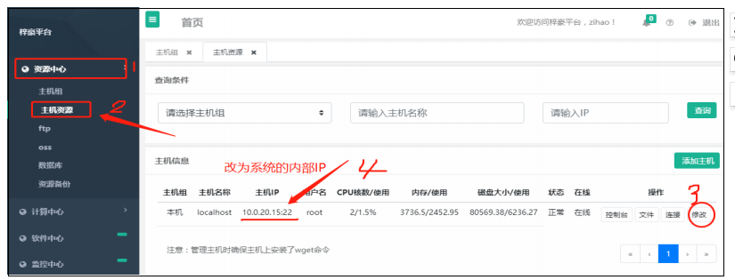
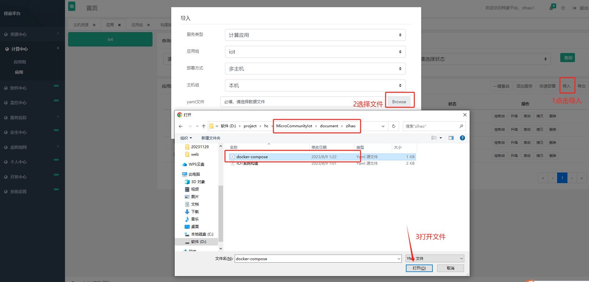
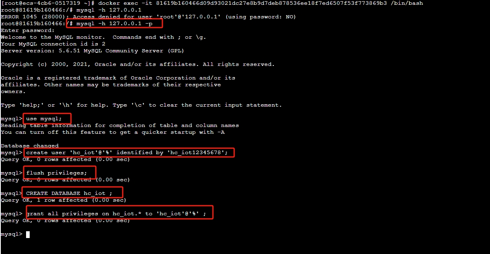
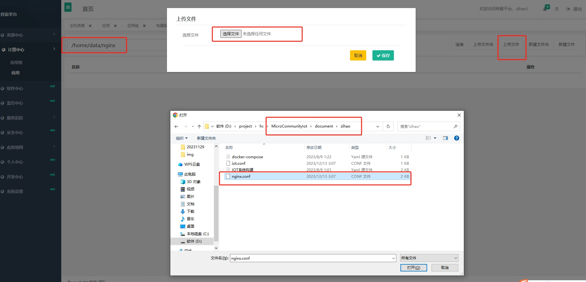

## HC物联网平台安装说明

物联网平台的安装推荐用梓豪的方式安装部署，这里推荐物联网提供单独的服务器来安装， 
以免物联网和设备的交互比较频繁，影响物业系统的正常使用。 下面就以梓豪方式安装。

### 1.0 准备资源
服务器：4核8G内存100G磁盘（推荐，如果是测试可以是2核4G内存40G磁盘） 
操作系统：centos7.6 
域名：备案过的域名（如果是三大运营商的主机，需要面向他们的主机备案），并且域名没有做过违法事情，主要是有些域名做过违法事情被微信拉入黑名单 
需要解析两个子域名，比如 iot.xx.com 和 app.iot.xx.com 
公众号：服务号认证过的 
开放端口：80/443 1883（mqtt） 20011(netty) 7000 3306(部署完成后可以关闭)

### 2.0 安装梓豪

梓豪平台安装是非常简单的，我们可以通过以下命令
直接安装:
yum install -y wget && wget https://homecommunity.oss-cn-beijing.aliyuncs.com/install.sh -O zihaoinstall.sh && sh zihaoinstall.sh
等待安装完成

等梓豪平台系统安装完以后，然后登陆进入梓豪平台
浏览器访问 http://ip:7000 账号为 zihao 密码为 123456 

在梓豪平台系统资源中心，主机资源里面进去修改服务器 IP(一定要改为内部 IP)如下图

### 3.0 安装 物联网

梓豪平台下计算中心，应用组下新建一个iot 的组，在应用页面选择导入功能，导入文件为
MicroCommunityIot/document/zihao目录下docker-compose.yml,如下图：

### 4.0 应用hosts ip

这里需要修改的是nginx应用和iotboot 应用下的hosts 中的ip，这里需要修改为内网ip，但是
不能为127.0.0.1（这里说的不能为127.0.0.1）

### 5.0 启动mysql 和 redis

在应用下启动 mysql 和 redis 这里确保你的主机上没有占用3306和6379

### 6.0 连接数据库 导入 数据

点击应用下mysql控制台> docker容器 点击进入，在命令框中 执行如下命令进入数据库
> mysql -h 127.0.0.1 -p  
> 密码为123456  
> use mysql; 
> create user 'hc_iot'@'%' identified by 'hc_iot12345678'; 
> flush privileges; 
> CREATE DATABASE hc_iot CHARACTER SET utf8mb4 COLLATE utf8mb4_unicode_ci; 
> grant all privileges on hc_iot.* to 'hc_iot'@'%' ; 

navcate 连接 数据库导入数据,数据库文件 MicroCommunityIot/document/db/hc_iot.sql

### 7.0 用源码构建

进入梓豪软件中心下的 构建版本 导入文件MicroCommunityIot/document/zihao目录下
IOT系统构建.yml

在资源中心>主机资源下，点击连接进入服务器，安装git 和maven

> yum -y install git 
> yum -y install maven  

构建版本 中点击构建

### 8.0 配置nginx 并且启动

在服务器上新建 /home/data/nginx 目录 并且上传 MicroCommunityIot/document/zihao
目录下的nginx.conf文件

在应用下启动nginx 服务

### 9.0 软件商店中安装mqtt服务器

在软件商店中安装 activemq-artemis 并且启动即可

