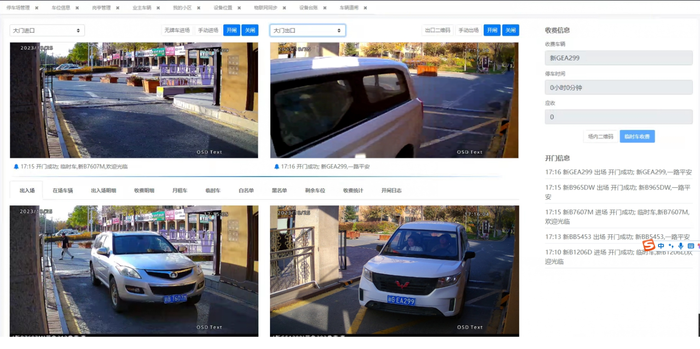

## HC 物联网系统

HC物联网系统专注于小区和园区内的设备管理，智能化控制，包括如下：

房产：小区或者园区的楼栋、单元、房屋和业主，可以通过添加或者excel批量导入的方式导入；

门禁：门禁设备管理，楼栋下人员授权门禁设备，员工部门授权门禁设备，通过修改业主的方式或者修改员工的方式
下发人员信息到门禁；通过门禁卡，人脸和通行码的方式门禁开门；访客申请生成访客码，一定时间内通行；统计
门禁人员；

道闸：包含道闸相关的全部功能，已有道闸或者新道闸可以通过更换摄像头的方式彻底接管车辆进出功能，避免
对接各式各样的道闸，月租车，临时车收费，商家赠送优惠券和月卡购买等功能；

充电桩：两轮摩托车充电功能，扫二维码选择充电小时开始充电；也支持月卡购买功能；

智能水电表：手机端选择电表或者水表后在线充值，充值到智能水电表，水电表的开闸关闸功能；

梯控：电梯管理，包括人脸下发门禁后，刷脸自动停靠相应楼层功能；

监控：支持海康大华等摄像头，小区监控更加安全；

门锁：适用于公祖房等场景，物业同意配备门锁，远程开锁，密码开锁等；

仪表：小区内水流量 压力 温度等检测仪表，实时告警功能；

考勤设备：考勤设备管理，人脸下发，人脸考勤等；

事件： 设备离线，仪表告警等通过事件方式 通过短信 或者微信模版消息方式告警；

## 技术选型

java + vue + uni-app + maven + spring boot(cloud) 方式

## 如何体验

演示环境：http://iot.homecommunity.cn

运营账号密码：admin/admin

物业账号：18909715555/123456

物业账号可以自行到admin 添加

本机环境：http://localhost:3002

## 如何部署

梓豪部署：[安装](./document/cn/install.md)

数据库sql: [mysql文件](./document/db/hc_iot.sql)

## 接口文档

地址为：http://localhost:9999/doc-ui.html

[word接口文档](./document/protocol)

## 设备配置文档

[门禁配置文档](./document/HC物联网门禁配置指南.docx)

[道闸配置文档](./document/HC物联网道闸配置指南.docx)

[充电桩配置文档](./document/HC物联网两轮充电桩配置指南.docx)

## 运行效果

pc 端登录页面 
 
pc 端物业账号效果图 
 
pc 端admin账户效果图 
 
pc 端dev账户效果图 
 

道闸商用截图
 

用户端首页效果图和用户端服务页面效果图

用户端我的页面效果图和

