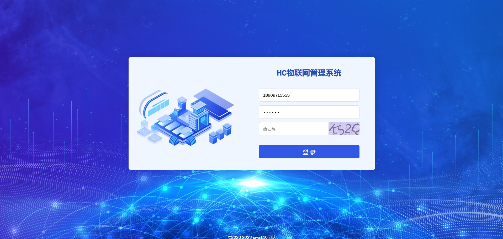
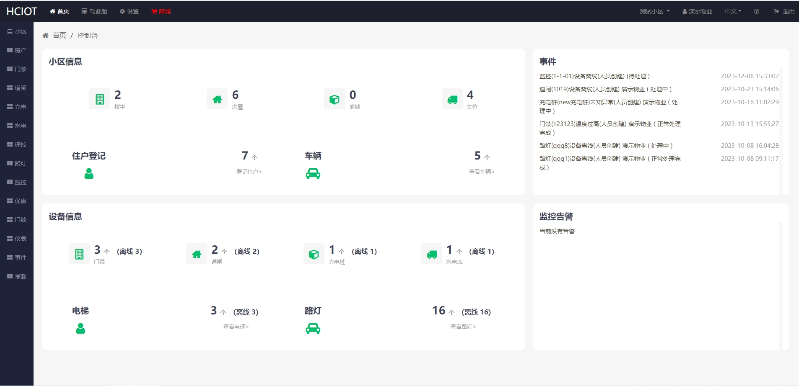
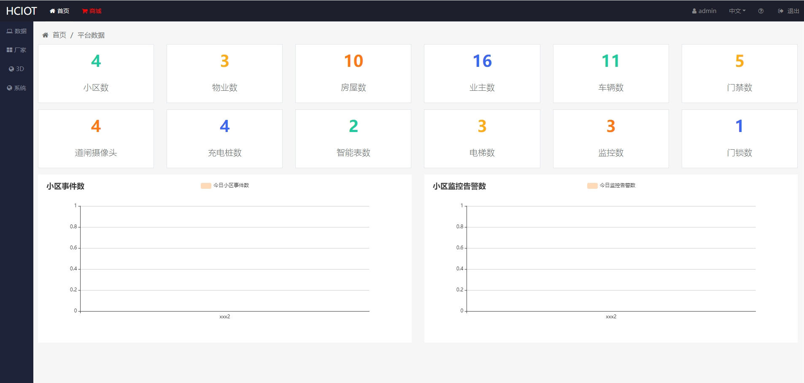
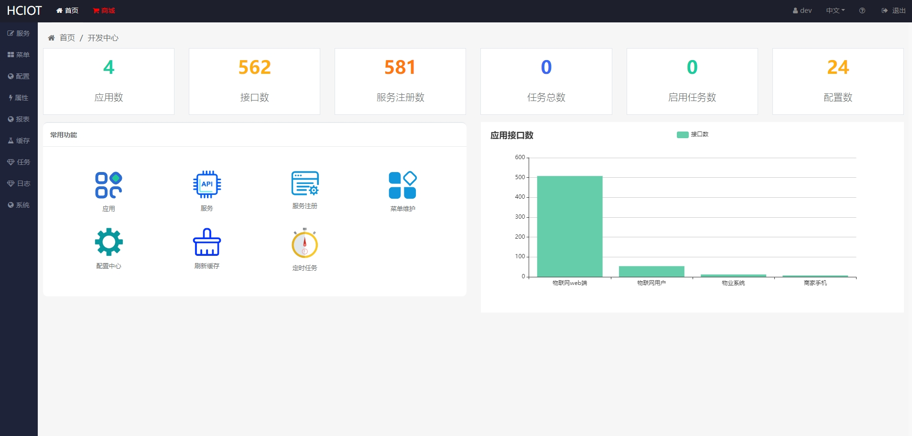
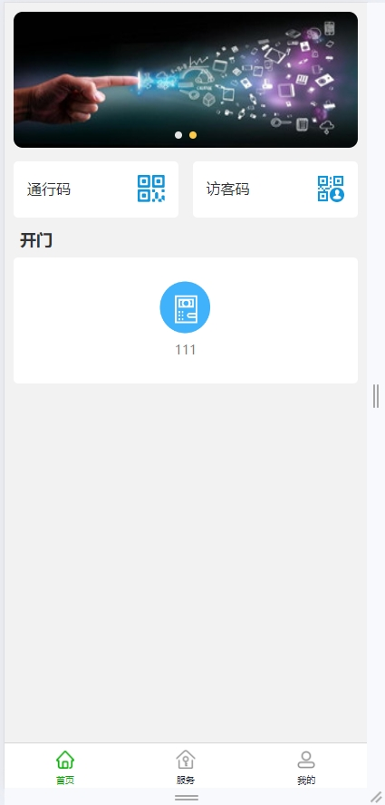
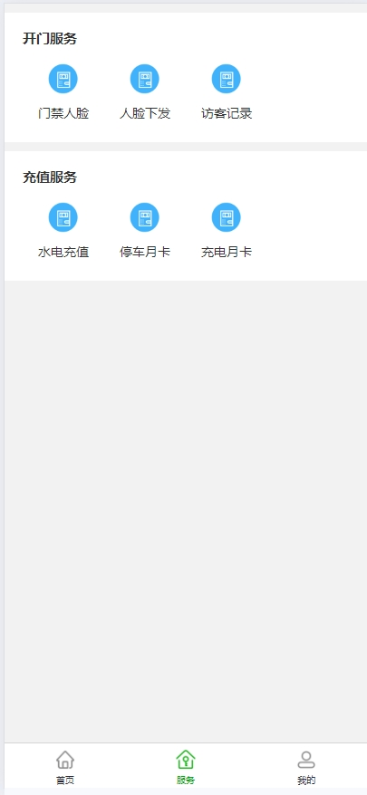
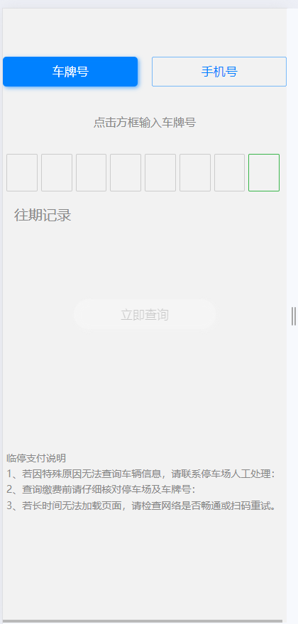

## HC 物联网系统

HC物联网系统专注于小区和园区内的设备管理，智能化控制，包括 门禁 道闸 考勤机 充电桩等

## 如何体验

演示环境：http://iot.homecommunity.cn

本机环境：http://localhost:3002

## 如何部署

梓豪部署：[安装](./document/cn/install.md)

## 接口文档

地址为：http://localhost:9999/doc-ui.html

## 运行效果

pc 端登录页面 
 
pc 端物业账号效果图 
 
pc 端admin账户效果图 
 
pc 端dev账户效果图 
 
用户端首页效果图 
 
用户端服务页面效果图 
 
用户端我的页面效果图 
 
临时车扫码支付页面 
 

